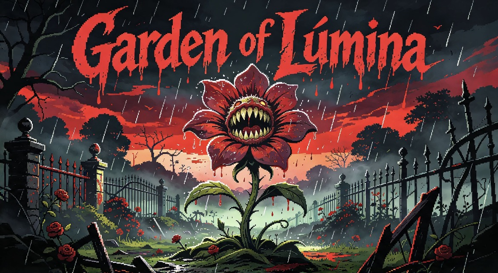

# 🌸 Garden of Lúmina
> **Jogo de Terror Psicológico e Exploração**

---

### 📖 Sobre o Jogo
Há muitos anos, existia um parque chamado Jardim das Cores. Sua maior atração era Lúmina, uma flor animatrônica que foi criada para espalhar alegria. Um dia, ela mudou: suas cores escureceram, sua voz ficou distorcida, e o parque foi fechado e abandonado por mais de 20 anos.

Você entra lá para descobrir o que aconteceu e desligá-la. Mas descobre que ela não é má — está apenas sozinha demais. No final, você decide: desligá-la para sempre ou dar a ela uma segunda chance.

---

### 🎮 Jogar
🔗 **[Clique aqui para jogar](https://inaciosegundaria-ux.github.io/Garden-Of-Lumina/)**
